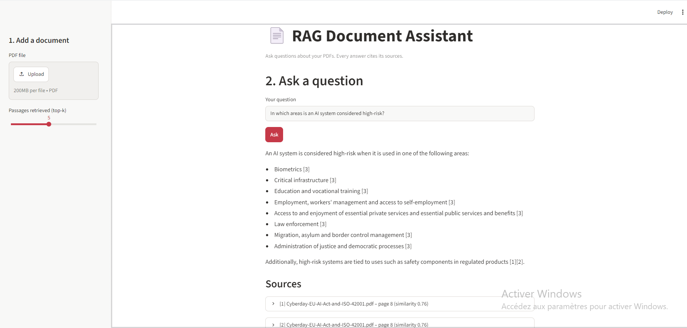
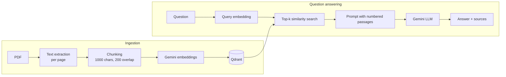

# 📄 RAG Document Assistant

End-to-end **Retrieval-Augmented Generation** application: upload PDFs, ask questions in natural language, and get answers **grounded in your documents, with cited sources** (file + page).

Built as a production-style project: REST API, vector database, containerized deployment, and a retrieval evaluation pipeline.



## ✨ Features

- **PDF ingestion**: text extraction per page, overlapping chunking, embeddings, indexing in Qdrant
- **Semantic search** with cosine similarity (Gemini embeddings, query/document task types)
- **Grounded answers with citations** `[1]`, `[2]`, and an explicit *"not found in the documents"* when the context is insufficient
- **REST API** (FastAPI) with interactive docs at `/docs`
- **Web demo** (Streamlit)
- **Retrieval evaluation**: Hit rate@k and MRR on a labelled question set
- **One-command deployment** with Docker Compose
- **Idempotent indexing**: re-uploading a document overwrites its chunks instead of duplicating them

## 🏗️ Architecture



## 🧰 Tech stack

| Layer | Tool |
|---|---|
| LLM & embeddings | Google Gemini API (`gemini-2.5-flash`, `gemini-embedding-001`) |
| Vector database | Qdrant |
| API | FastAPI + Pydantic |
| UI | Streamlit |
| Deployment | Docker, Docker Compose |
| Tests | Pytest |

## 🚀 Quickstart

### Option 1: Docker Compose (recommended)

```bash
git clone https://github.com/salmita2023/rag-document-assistant.git
cd rag-document-assistant
cp .env.example .env        # then add your GEMINI_API_KEY
docker compose up --build
```

- Web demo: http://localhost:8501
- API docs: http://localhost:8000/docs
- Qdrant dashboard: http://localhost:6333/dashboard

### Option 2: Local Python

```bash
python -m venv .venv
.venv\Scripts\activate          # Windows  (source .venv/bin/activate on macOS/Linux)
pip install -r requirements.txt
docker run -d --name qdrant -p 6333:6333 qdrant/qdrant
uvicorn app.main:app --reload    # terminal 1
streamlit run ui/streamlit_app.py  # terminal 2
```

## 🔌 API

```bash
# Index a PDF
curl -F "file=@data/my_document.pdf" http://localhost:8000/upload

# Ask a question
curl -X POST http://localhost:8000/ask -H "Content-Type: application/json" \
     -d '{"question": "What are the obligations for high-risk AI systems?", "top_k": 5}'
```

Response:

```json
{
  "answer": "Providers must ... [1][3]",
  "sources": [{"source": "my_document.pdf", "page": 42, "score": 0.83, "text": "..."}]
}
```

## 📊 Evaluation

A RAG system is only as good as its retrieval. `evaluation/dataset.json` contains questions labelled with the page where the answer is located.

```bash
python -m evaluation.evaluate --top-k 5
```

| Metric | Value |
|---|---|
| Hit rate@5 | 1.0 |
| MRR | 0.792|

## 🧠 Design choices

- **Chunk size 1000 / overlap 200**: large enough to keep a full idea, overlap so that sentences cut at a boundary are still retrievable. Configurable in `.env`.
- **Different task types for documents and queries**: Gemini optimizes embeddings for asymmetric retrieval (short question vs. long passage).
- **768-dimension embeddings**: good quality/storage trade-off (Matryoshka truncation of `gemini-embedding-001`).
- **Low temperature (0.1) and a strict system prompt**: limit hallucinations and force citations.
- **Configuration through environment variables**: models, chunking and top-k can change without touching the code.

## 🗺️ Roadmap

- [ ] Hybrid search (BM25 + vectors) and re-ranking
- [ ] Answer-quality evaluation (faithfulness, LLM-as-a-judge)
- [ ] Interchangeable LLM providers (Mistral, Ollama)
- [ ] Conversation memory

## 🧪 Tests

```bash
pytest
```
